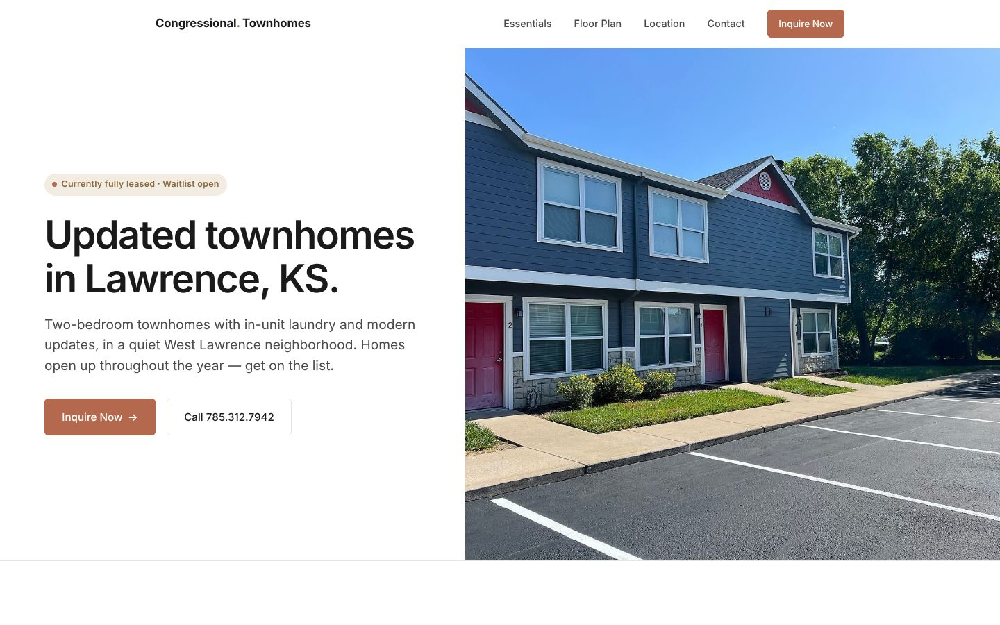
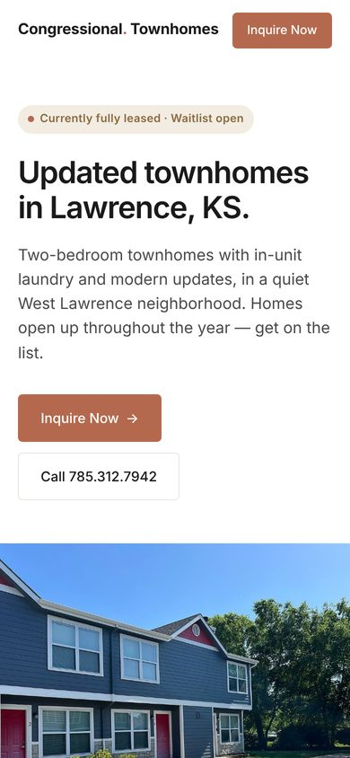
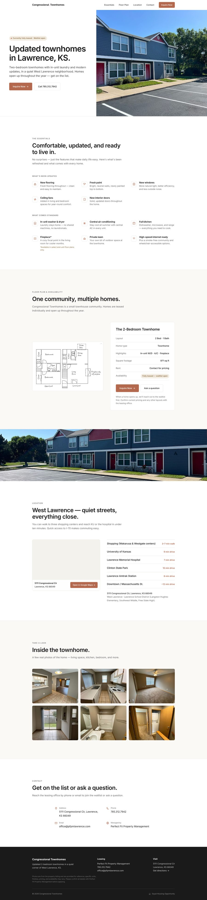

# Congressional Townhomes: Rental Property Website

A single-page marketing and lead-capture website for Congressional Townhomes, a two-bedroom townhome community in West Lawrence, Kansas, managed by Perfect Fit Property Management.

> **The source code is kept private** because the site belongs to the client. This repository is a case study: what the site needed to do, how it was built, and what it looks like.

**Live site: https://congressionaltownhomes.com/ 

## The problem

The property was fully leased but kept turning over units through the year. The property manager needed:

- One place to send prospective tenants that showed the homes, floor plan, and location
- A way to collect waitlist sign-ups and questions without a phone call
- Something that ranks in local search for "2-bedroom townhomes for rent in Lawrence, KS"

## What I built

A fast, self-contained single page with six sections: hero, essentials (updates and standard features), floor plan and availability, location, photo gallery, and contact.

| Area | What it does |
|------|--------------|
| **Lead capture** | Contact and waitlist form that delivers to the leasing office's inbox through Web3Forms, with a pre-filled email fallback if the form service is unreachable |
| **Local SEO** | Search-focused title and description, schema.org structured data for the property, geo meta tags, and a canonical URL |
| **Social sharing** | Open Graph and Twitter card tags with a custom preview image, so links shared by text or social media show a proper card |
| **Responsive design** | Layouts adjust for phone, tablet, and desktop, with a simplified mobile nav |
| **Accessibility** | Respects the "reduce motion" system setting and uses semantic headings and labeled links |
| **Print-friendly** | A print stylesheet so the page can be printed as a flyer for the leasing office |
| **Location** | Embedded Google Map plus walk and drive times to KU, shopping, the hospital, and I-70 |
| **No dependencies** | One HTML file with embedded photos and a system font stack, so it can be hosted for free on almost any static host |

## Screenshots

| Mobile | Full page |
|--------|-----------|
|  |  |

_The map area appears blank in the full-page capture because it was taken offline; on the live site it shows an embedded Google Map._

## Built with

HTML5 · CSS (Grid, Flexbox, media queries) · vanilla JavaScript · Web3Forms · schema.org JSON-LD · Google Maps embed

Built with AI-assisted development. I gathered the requirements and content from the property owner, chose the photos and layout, reviewed and tested the page on desktop and mobile, and handled delivery.

## What I'd do next

- Connect a custom domain and submit the site to Google Search Console
- Add analytics to measure how many visitors join the waitlist
- Move the photos out of the HTML file and compress them, so the page loads faster on mobile data

